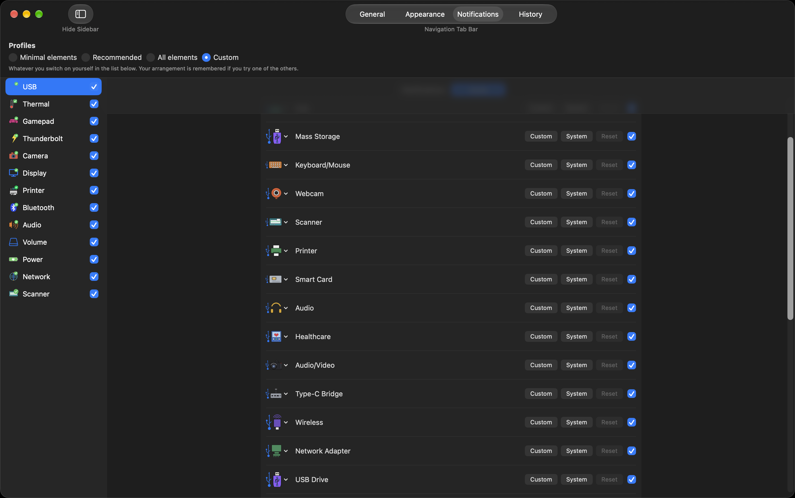
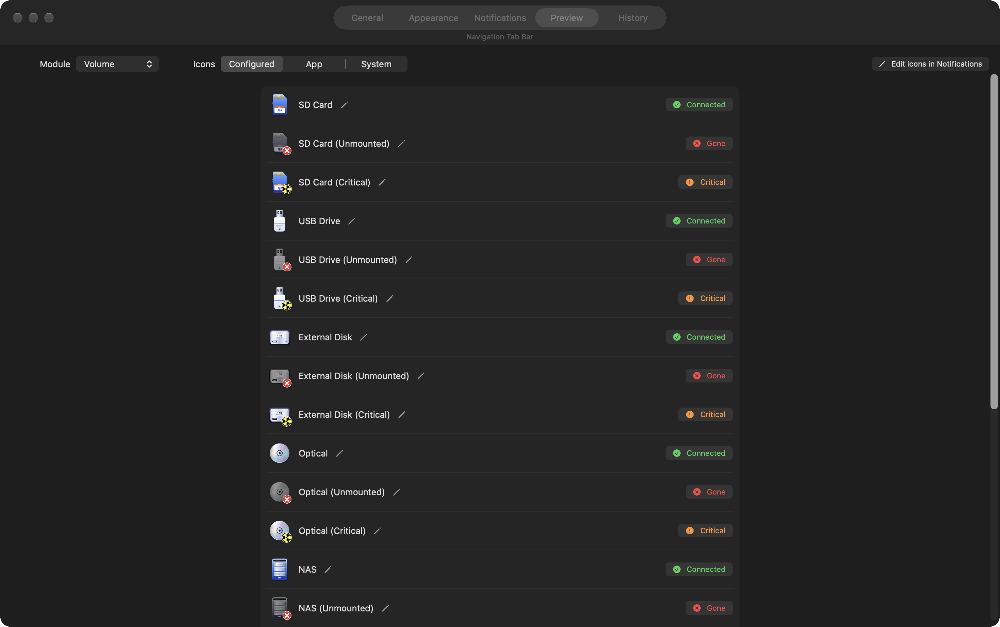

# HardwareSentry

A menu-bar application that watches the hardware attached to a Mac and says when something
changes — a drive plugged in, a display waking, the Wi-Fi network switching, the machine
starting to throttle because it is hot.

Requires macOS 15 or later. Apple Silicon.

**Status:** version 1.8.0. Every module below is ported and covered by the parity audit; see
[`CHANGELOG.md`](CHANGELOG.md) for what has changed and [Known issues](#known-issues) for what is
understood, small, and not yet worth holding a release for.

[Download the latest release](https://github.com/jensyleo/HardwareSentry/releases/latest)
— unsigned, so the first launch needs a right-click ▸ Open. Each release carries a `.dmg` and a `.zip`.





## What it does

Thirteen modules, each watching one kind of hardware: Audio, Bluetooth, Camera, Display,
Gamepad, Network (including Wi-Fi, VPN, DNS and proxy), Power, Printer, Scanner, Thermal,
Thunderbolt, USB and Volume.

Each raises notifications you can switch on and off individually, and each message can
carry extra detail lines you choose. A mounted network drive whose server stops answering —
which macOS never reports, since it keeps the share mounted — is reported too, and so is its
return. Notices that used to repeat what was already known (IP addresses, proxy settings, a
default audio device, a power source) can be limited to what actually changed.

Notification icons are macOS's own picture of each device by default — the exact model, for
Apple's accessories — with a small mark for connected, disconnected or needing attention. Any
module, or any single notification, can use this application's own artwork, an SF Symbol or a
picture of your own instead. The application's own artwork carries its state in the picture
itself (a cross, a warning triangle, a radiation mark), so a notice never needs a second badge on
top of it.

`Help ▸ HardwareSentry Help` documents every module, notification and setting; that reference is
generated from the modules themselves, so it describes what the build in front of you actually does.

### Settings

- **Notifications** — the module switches, each notification, and the extra lines inside a message.
- **Icons** — one picture per notification, with a button to restore the defaults.
- **Preview** — shows any notification on demand, in each state it can really have, with the
  picture that is configured, the application's own, or macOS's. Nothing on the Mac changes.
- **Appearance** — corner, display, width, text size, background and opacity, themes (with
  automatic light and dark ones), shape and border, per-kind styles (good, warning, critical),
  quiet hours, per-module sound, corner and time on screen, and an option (off by default) to
  group plain notices that arrive together into one banner.
- **History** — what was shown, kept locally.

Critical is a level of its own, apart from needing attention: a disk that cannot be read, a volume
out of space, an unsafe eject, a severe thermal state and a failing battery carry the radiation mark.

## It draws its own notifications

The banners are drawn by the application rather than handed to macOS. Handing a
notification to the system means giving up control of the corner, the size, how long it
stays and what it is drawn on, and it makes the application depend on a permission the user
has to grant. The trade-off is that these notifications do not appear in Notification
Centre and Do Not Disturb does not silence them.

## Permissions

Two, both only because macOS requires them to read something specific, and neither used for
anything else:

- **Bluetooth** — needed to see Bluetooth devices connecting at all.
- **Location** — needed only to read the *name* of the Wi-Fi network being joined. macOS
  treats a network name as a location. The actual location is never read.

The Scanner module also triggers the Local Network prompt, which is why it ships switched
off. So does Volume while a network drive (SMB, AFP, NFS, WebDAV or FTP) is mounted: it
checks that the drive's server is still answering, by opening one connection to it — nothing
is read from the drive. If that permission is refused the check simply stays quiet; it never
reports a server as down that it has not first seen answer.

## Building

```
xcodegen generate
xcodebuild -project HardwareSentry.xcodeproj -scheme HardwareSentry -configuration Release build
```

Everything needed is in this repository, apart from the notification core (see [SignalCore](#signalcore)),
which Swift Package Manager fetches on the first build.

Tests live in the `HardwareSentryCore` package; the notification core has its own:

```
cd HardwareSentryCore && swift test
```

A third check compares what this application can notify about against the earlier application it
was rewritten from, so nothing is quietly lost in the rewrite:

```
Tools/parity-audit.sh [path-to-original]
```

It exits non-zero on a gap. See [Parity](#parity) for what it covers and what it cannot.

## SignalCore

The notification core, [SignalCore](https://github.com/jensyleo/SignalCore), is a Swift package of its own,
application-agnostic, so it can serve other applications too. This application depends on it by version
(`HardwareSentryCore/Package.swift`), and Swift Package Manager fetches it the first time the project is built.
It draws the self-made banners, themes, quiet hours, the corner for each module and the optional grouping of
notices that arrive together, runs the dispatcher and its middleware pipeline, and stores the preferences.

## Parity

HardwareSentry is a rewrite, not a port: no code is shared with the application it replaces, and the
modules were written one at a time against macOS APIs directly. That raises the question of whether
anything was lost on the way, so the check is mechanical: `Tools/parity-audit.sh` reads the original's
sources and this application's own catalogue (the same list the settings window renders, dumped as
JSON by the `sentry-inventory` executable) and exits non-zero when the original can do something this
one cannot. Being ahead is reported but never fails. It checks three axes:

| Axis | What it checks | Map file for deliberate differences |
|---|---|---|
| Notifications | every notification the original can raise can be raised here | `Tools/parity-map.tsv` |
| Optional lines | every "show this too" preference has somewhere to come from | `Tools/parity-fields.tsv` |
| Tuning | every interval, threshold, mode and remembered date is reachable | `Tools/parity-settings.tsv` |

It also fails on a module or event with no icon — the regression that recurred in five modules, when
the icon was inferred from a module's first event and reordering the list silently changed it.

At the last measured count the original declared 106 notifications; this application has 13 modules
and more than 200 events. Every original notification is covered, 97 by name and 9 by mapping to 16
finer-grained events: a single "signal changed" becomes five Wi-Fi bands, five Bluetooth bands and the
four thermal pressure levels, so "tell me when I am about to lose the connection, and not every time it
wobbles" is a checkbox.

Deliberate differences: `transmitPower` is shown in milliwatts as CoreWLAN returns it, not mislabelled
as dBm; battery health is checked in days, not months-plus-unit (which allowed a "0 months" that meant
never); the experimental video-link detection has no switch of its own, since its notification's
checkbox is the switch; volumes can be ignored individually; and Gamepad has no keyboard/mouse row,
because with that switch on an entirely ordinary keyboard and mouse announced themselves through it.

What it does not prove: parity of declarations is not parity of behaviour. NVMe SMART attributes (an
Apple Fabric controller exposes no `IONVMeController`), printer notifications and network scanner
discovery could not be exercised on the development machine; walking out of Wi-Fi range, pairing
headphones or connecting an external display still need a person and a cable. AirPods battery level uses
public IORegistry properties where they exist and guarded private selectors otherwise; if Apple removes
them the battery line stops appearing and nothing else changes. Measured side by side over two idle
minutes, the two applications cost about the same CPU, and this one uses less memory (about 81 MB
against 138 MB).

## Known issues

Small, understood defects that were not worth holding a release for. Anything larger belongs in the
code it affects.

**Fixed, with the lesson kept**

- *USB classification races.* A device's registry entry is replaced during driver matching, so reading
  it once at connect can disagree with reading it at disconnect (a webcam, an external disk, a gamepad
  and a microSD reader each showed it). The fix is the same everywhere: re-find the device by
  vendor/product/location and retry briefly, caching what resolved so the disconnect reads the same.
- *Classification order.* A keyboard publishes several HID interfaces; usages are now ranked
  (Generic Desktop over Digitizers over Consumer Control) instead of taking whichever enumerates first.
- *Last-resort guesses must lose to real answers.* A wired Ethernet adapter in a dock was announced as
  Wi-Fi, a Billboard chip as a serial adapter and a USB-serial adapter was silenced as "vendor specific":
  a real, named class now always beats a vendor-ID guess, and "Vendor Specific", "Application Specific"
  and "Miscellaneous" count as no answer at all. Keywords such as "WLAN" are matched as whole words.
- *Mass-storage kind.* Flash drives, SD card readers and external disks are told apart by the disk's own
  protocol and media name, reading Disk Arbitration rather than the class byte.

**Not bugs**

- *Gamepad Monitor stays silent for most real controllers.* `GameController.framework` only reports
  controllers on Apple's own internal list; a licensed or generic USB pad is never reported to any
  application. USB Monitor's own Gamepad/Joystick notice is the only one such a controller gets, which is
  why "Notify for USB devices independently of USB Monitor" is on by default.
- *The experimental "Video Link Detected" warning is confirmed working* against a real USB-C-to-HDMI
  cable. The kernel log line it keys on carries no port, cable type or display identity, so the message
  cannot say more; naming the port was tried and rejected, because the log line it needed fires about
  eleven times as often as a real connect.

**Open**

- *"Ignore identified devices without their own icon"* works (a hub's internal Billboard interface is
  silenced, hubs, network adapters and mass storage are untouched), but it is one all-or-nothing switch
  that conflates "no icon" with "not interesting". Revisit if a class shows up that it gets wrong.
- *The flash-drive and SD-card heuristic* is a scoped copy of Volume's own, and imperfect where it came
  from: it matches token lists against a disk's protocol and name with no ground truth. It has not been
  watched against a real flash drive and a real SD reader with the icons in front of a person.
- *Per-module Simulate.* Every module offers a generic "Simulate a Notification"; only Thermal has its own,
  because its events are transitions. Power, Volume (a percentage free) and Network (signal level, lease)
  are candidates for the same treatment and have not been reviewed module by module.
- *"First disconnection after launch is still announced"* was written against an implementation that no
  longer exists and needs re-testing against the current code.

## Security

Only the latest release is supported. HardwareSentry only **reads** hardware and system state (IOKit,
Disk Arbitration, CoreWLAN, CUPS, AVFoundation, IOBluetooth and similar) — it never writes to, mounts,
formats or ejects a device, never sends anything over the network, runs as the logged-in user with no
elevated privileges, and requests only the permissions listed above. It keeps its own history locally.

Relevant reports: a code path that reads, transmits or persists more than a module's documented fields
describe; a crash or memory-safety issue in a C bridge (`CCUPS`, `CNVMeSMART`) or a system call reachable
from a malformed USB, Bluetooth, CUPS or Bonjour advertisement; a switched-off module or notification that
still leaks information about a device; any path that modifies a device (the application is read-only by
design, so any such path is itself the bug); unsanitised input reaching a shell command or `Process`. Not a
vulnerability: the banners not appearing in Notification Centre and not being silenced by Do Not Disturb,
which is by design.

Report privately with GitHub's "Report a vulnerability" (Security tab), including the version and macOS
version, steps to reproduce and the impact. You should get an initial response within a few days; confirmed
issues are fixed and credited in the release notes unless you ask otherwise. See also [`SECURITY.md`](SECURITY.md).

## Licence

GNU General Public License v3 — see [`LICENSE`](LICENSE).

## Inspiration

HardwareSentry is inspired by HardwareGrowler, part of The Growl Project: seeing it in use
is what suggested which categories of hardware events are worth reporting at all. It is
otherwise independent — a clean-room Swift rewrite that shares no source code, artwork, or
text with HardwareGrowler. The architecture (one actor per monitor behind a declared
contract, a middleware dispatch pipeline, per-event preferences), the notification drawing
and appearance system, and every icon are original to this project.

The Growl Project does not endorse this application.

## Trademarks

Bluetooth® is a registered trademark of Bluetooth SIG, Inc. Wi-Fi® is a registered
trademark of Wi-Fi Alliance. Thunderbolt and the Thunderbolt logo are trademarks of Intel
Corporation. USB Type-C® is a registered trademark of USB Implementers Forum. Used here to
identify the hardware being reported on; no affiliation or endorsement is claimed.
