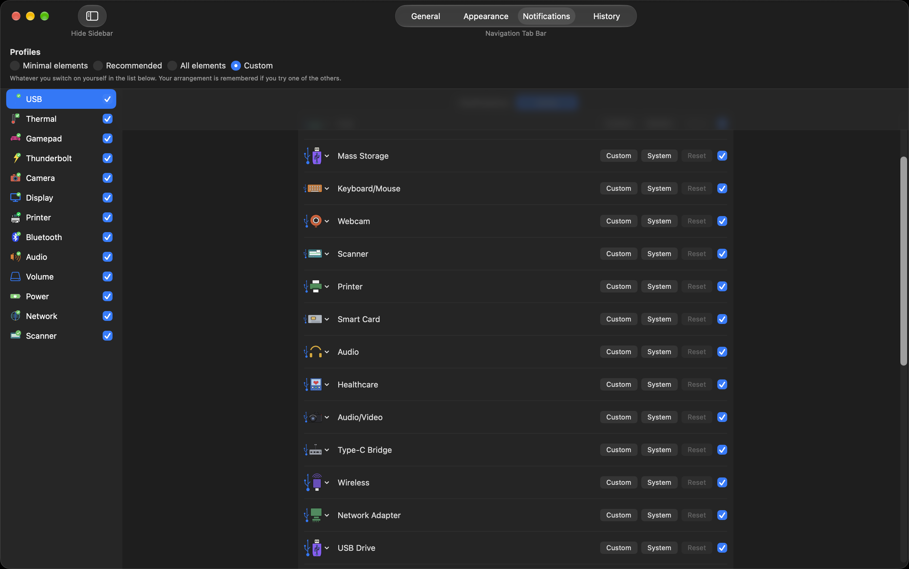

# HardwareSentry

A menu-bar application that watches the hardware attached to a Mac and says when something
changes — a drive plugged in, a display waking, the Wi-Fi network switching, the machine
starting to throttle because it is hot.

Requires macOS 15 or later. Apple Silicon.

**Status:** version 1.2.1. Every module below is ported and
covered by the parity audit; see `CHANGELOG.md` for what has changed and `KNOWN-ISSUES.md`
for what is understood, small, and not yet worth holding a release for.

[Download the latest release](https://github.com/jensyleo/HardwareSentry/releases/latest)
— unsigned, so the first launch needs a right-click ▸ Open.



## What it does

Thirteen modules, each watching one kind of hardware: USB, Thunderbolt, Bluetooth, network,
Wi-Fi, displays, volumes, power, thermal state, audio devices, cameras, printers, game
controllers, and network scanners.

Each raises notifications you can switch on and off individually, and each message can
carry extra detail lines you choose. A mounted network drive whose server stops answering —
which macOS never reports, since it keeps the share mounted — is reported too, and so is its
return. Notification icons are macOS's own picture of each
device by default — the exact model, for Apple's accessories — with a small mark for
connected, disconnected or needing attention; any module, or any single notification, can
use this application's own artwork, an SF Symbol or a picture of your own instead. `Help ▸ HardwareSentry Help` documents every module,
notification and setting; that reference is generated from the modules themselves, so it
describes what the build in front of you actually does.

## It draws its own notifications

The banners are drawn by the application rather than handed to macOS. Handing a
notification to the system means giving up control of the corner, the size, how long it
stays and what it is drawn on, and it makes the application depend on a permission the user
has to grant. The trade-off is that these notifications do not appear in Notification
Centre and Do Not Disturb does not silence them.

## Permissions

Two, both only because macOS requires them to read something specific, and neither used for
anything else:

- **Bluetooth** — needed to see Bluetooth devices connecting at all.
- **Location** — needed only to read the *name* of the Wi-Fi network being joined. macOS
  treats a network name as a location. The actual location is never read.

The Scanner module also triggers the Local Network prompt, which is why it ships switched
off. So does Volume while a network drive (SMB, AFP, NFS, WebDAV or FTP) is mounted: it
checks that the drive's server is still answering, by opening one connection to it — nothing
is read from the drive. If that permission is refused the check simply stays quiet; it never
reports a server as down that it has not first seen answer.

## Building

```
xcodegen generate
xcodebuild -project HardwareSentry.xcodeproj -scheme HardwareSentry -configuration Release build
```

Everything needed is in this repository. The notification core, `SignalCore`, is its own
Swift package in the `SignalCore/` folder — application-agnostic, so it can serve other
applications too.

Tests live in the `HardwareSentryCore` and `SignalCore` packages:

```
cd HardwareSentryCore && swift test
cd SignalCore && swift test
```

A third check compares what this application can notify about against HG4MAC, so nothing
is quietly lost in the rewrite:

```
Tools/parity-audit.sh [path-to-HG4MAC]
```

It exits non-zero on a gap. See `PARITY.md` for what it covers and what it cannot.

## Documentation

- `CHANGELOG.md` — what has been built so far, module by module.
- `KNOWN-ISSUES.md` — small, understood defects and open design questions, kept out of
  the code they affect.
- `PARITY.md` — what the parity audit covers, and what it structurally cannot.
- `SECURITY.md` — this project's security scope, and how to report a vulnerability.
- `Help ▸ HardwareSentry Help`, inside the application itself — generated from the
  modules, so it always describes the build in front of you.

## Licence

GNU General Public License v3 — see `LICENSE`.

## Inspiration

HardwareSentry is inspired by HardwareGrowler, part of The Growl Project: seeing it in use
is what suggested which categories of hardware events are worth reporting at all. It is
otherwise independent — a clean-room Swift rewrite that shares no source code, artwork, or
text with HardwareGrowler. The architecture (one actor per monitor behind a declared
contract, a middleware dispatch pipeline, per-event preferences), the notification drawing
and appearance system, and every icon are original to this project.

The Growl Project does not endorse this application.

## Trademarks

Bluetooth® is a registered trademark of Bluetooth SIG, Inc. Wi-Fi® is a registered
trademark of Wi-Fi Alliance. Thunderbolt and the Thunderbolt logo are trademarks of Intel
Corporation. USB Type-C® is a registered trademark of USB Implementers Forum. Used here to
identify the hardware being reported on; no affiliation or endorsement is claimed.
